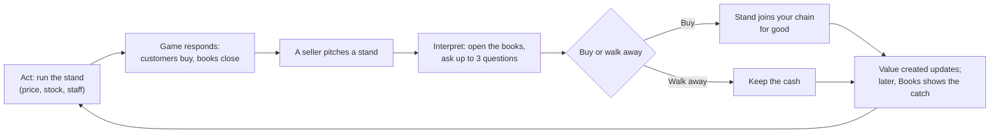

# The Next Dollar: Capital Allocation

Initial Game Design Document

Version: Initial (G1), November 15, 2026. Owner: the student, as Creative Director. Drafted with agent help; the student decides.

Each section carries one label:

- **Implemented:** in the code today. I opened the file named before writing it.
- **Planned:** designed for the final and still to be built.
- **Open question:** not decided or not known.

Decisions are marked **(student decided)**. Agent recommendations the student has approved are marked **(recommended, approved)**.

## 1. Summary

**The X (student decided):** You grow a lemonade stand into a New York chain one deal at a time, and feel the thrill of catching a bad deal before you sign something you can never undo.

The game is the existing single-player Career mode, refined. One account gets one business, with no restarts. You walk real New York neighborhoods, each with its own rent and crowd, and meet sellers there, each with their own stand, books and asking price. Each seller pitches you their business, and you can ask each seller up to three questions in your own words. Each seller is voiced by an AI agent that talks up the good numbers and stays quiet about the weak one. It may dodge a question, but it never states a false number. You read the seller's books, find the catch or decide there is none, then buy or walk away. Players rank on one all-time board by the total value their business creates.

**Under the surface (Implemented).** The lemonade stand sits on a real business model:

- Every sale and cost goes into one double-entry ledger, which produces an income statement, a balance sheet and a cash flow statement (`web/src/domain/ledger.ts`, shown in the Books screen).
- The score charges 5% a day on money tied up in stock and equipment (`VALUE_POLICY.hurdle` in `web/src/domain/value.ts`).
- The player hires workers and managers and runs stands in several New York locations (`web/src/config/catalog.ts`).
- The player can buy an operating stand from a seller. Today there is one fixed offer (`web/src/ui/acquisition-offer.ts`).
- The October 31, 2026 release passed 1,537 web tests (`docs/HANDOFF.md`).

**Title (student decided):** The Next Dollar: Capital Allocation. The midterm used "The Next Dollar" for a different mode; the subtitle marks the final.

**The in-game agent (Planned):** one Gemini model writes each seller's pitch and answers the player's questions. The engine sets the deal: the books, the price and at most one weakness. The agent only writes words. Every number in every pitch and answer is checked against the engine before the player sees it.

## 2. Player, genre and platform

| Item | Detail | Label |
|---|---|---|
| Player | Students curious how businesses work, and people who invest by studying company fundamentals | Student decided |
| Motivation | Competition on one all-time board, ranked by total value created | Student decided |
| Genre | Single-player business simulation, with a shared leaderboard between players | Implemented (Career and its board exist) |
| Platform | Web browser, desktop and phone. No install | Implemented |
| Session | One sitting of play on a business that persists across sittings | Planned |

**What a playtest should show if the motivation works:** a player checks the board, then opens a seller's books twice before buying. We can count book opens, questions asked and time spent on each deal.

## 3. Pillars (student decided)

Pillars are the few priorities used to choose between designs when they conflict.

1. **Capital allocation.** Every dollar has a best use: build a stand, buy one or hold the cash, and choose where. The score charges you for money you tie up, so growth for its own sake loses.
2. **Permanence.** One business per account, with no do-overs. A bad purchase stays on your record, which is what makes reading the books matter.
3. **The books tell the truth.** Every number a player sees is true and comes from the engine. A deal's weakness can always be found in its published books. Sellers may stay quiet about it, but they never lie.

## 4. Core loop

The course defines a core loop as: the player acts, the game responds, the player interprets, and that leads to the next action.

| Step | What happens | Label |
|---|---|---|
| Act | Set price, buy lemons, hire and assign staff, open stands | Implemented |
| Respond | The engine runs customers and closes the day's books | Implemented |
| Seller pitch | A generated deal arrives with a pitch from the seller agent | Planned |
| Interpret | Read the seller's books and price, and ask up to three questions | Reading the books of one fixed seller is Implemented; questions are Planned |
| Choose | Buy or walk away. The choice cannot be undone | Buy is Implemented; permanence is Planned |
| Next action | Run the bigger or unchanged business, check the board. After a purchase plays out, Books points to the catch or confirms the deal was clean | Board is Implemented; showing the catch is Planned |

## 5. Mechanics

### 5.1 Running stands (Implemented)

Career starts with $30 of founder capital and one stand (`COST.capital` in `web/src/config/catalog.ts`). The player buys lemons, sets a price from $2 to $5, hires a worker or manager, scouts and opens new stands, and reads full financial statements in a screen called **Books**. Rent depends on the location: Park Corner $2, Campus Walk $3 and Broadway Corner $4 a day. A manager costs $5 a day. These figures are in the same catalog file.

### 5.2 Neighborhoods (student decided; partly Implemented)

The game uses real New York neighborhoods. Each one has its own daily rent and its own crowd. High-rent neighborhoods have customers who accept higher prices. Low-rent neighborhoods have customers who walk away sooner. So the same stand is a different business depending on where it sits: price, staffing and where to invest all change with location. Six neighborhoods are in scope for the prototype (student decided).

**What exists today (Implemented, checked in code):**

- Three neighborhoods with different rents in `PLOTS` in `web/src/config/catalog.ts`: Park Corner $2, Campus Walk $3 and Broadway Corner $4 a day. The New York map (`web/src/ui/new-york-geography.ts`) labels them as the real places Central Park, Columbia University and Broadway.
- The New York page (`web/src/ui/new-york-map.ts`) shows each neighborhood's rent and its announced visits, the potential demand for that day.
- Four customer types in `web/src/domain/career/customer-mix.ts`: in a hurry, quality seekers, value seekers and regulars. The mix rotates by day and is the same in every neighborhood.
- Each type has its own price sensitivity in `web/src/domain/customer-traits.ts`: value seekers 1.3, in a hurry 0.9, regulars 0.85 and quality seekers 0.75. A higher number means a customer is put off more by a higher price.

**Planned:** a separate crowd for each neighborhood, and three new neighborhoods: the West Village, the Financial District and Fifth Avenue.

**Starting values (proposed by agents; every new number is a starting value to be tuned by playtests and offline episodes, none is measured).** Rents for the three existing neighborhoods are the values in the code today. Mixes are percentages of in a hurry / quality seekers / value seekers / regulars. "Crowd price sensitivity" is the mix-weighted average of the trait values above; it shows that each proposed mix follows the rule that higher rent goes with less price-sensitive customers.

| Neighborhood | Daily rent | Customer mix (hurry / quality / value / regular) | Crowd price sensitivity | Typical price the crowd accepts | What makes it distinct |
|---|---|---|---|---|---|
| Central Park (Park Corner) | $2 (in code) | 15 / 10 / 55 / 20 | 1.10 | $2 to $3 | Families and walkers who watch the price |
| Columbia University (Campus Walk) | $3 (in code) | 20 / 15 / 45 / 20 | 1.05 | $3 | Students on a budget, with loyal regulars |
| Broadway (Broadway Corner) | $4 (in code) | 35 / 20 / 30 / 15 | 0.98 | $3 to $4 | Theater crowds in a rush before curtain |
| West Village | $5 (starting value) | 15 / 45 / 15 / 25 | 0.88 | $4 | Locals who pay for a good drink and come back |
| Financial District | $6 (starting value) | 50 / 30 / 5 / 15 | 0.87 | $4 to $5 | Office workers who want it fast |
| Fifth Avenue | $7 (starting value) | 25 / 50 / 5 / 20 | 0.84 | $5 | Shoppers and visitors who pay for quality |

The "typical price" column is the design target the tuning aims for. Prices stay within the game's existing $2 to $5 choices.

**Build notes.** Add the three new entries to `PLOTS` and the map, give each neighborhood a base mix, and have the customer draw use the mix of the neighborhood the stand is in. Whether the existing daily rotation stays on top of each base mix is an Open question.

### 5.3 Deals (Planned)

A **deal** is a stand that a seller offers to sell to the player. Rules:

- The engine creates each deal: its books (sales and costs over the last three periods), its asking price and at most one weakness.
- A **weakness** (also called the catch) is one fact that lowers what the stand is worth to the buyer. It is always visible in the published books to a careful reader. Examples: a manager wage of $0 because the seller worked the stand unpaid, or one unusually good period. Some weaknesses come from the location, because a seller's books only make sense for their neighborhood: a rent due to rise next period, or sales that depended on a price only one period's crowd would pay.
- Some deals are **clean**: they have no weakness and are fairly priced. Walking away from every deal should not be a safe strategy.
- The seller agent only writes words. It cannot change the books, the price or the outcome, and it cannot haggle.
- Buying is final. The stand joins the chain and its results count toward value created.

**Where the sellers are (Planned, student decided).** Sellers appear on the New York map, in different neighborhoods. Each seller is a character with a name, a way of talking and a reason for selling, and each has their own stand, books and asking price. One Gemini model voices all of them, and each conversation sees only its own deal. The player opens the map, clicks a neighborhood with a stand for sale, and the seller's deal panel opens with the pitch, the books and the question box. This builds on the map Career already has (`web/src/ui/new-york-map.ts`, Implemented): each neighborhood opens a card with its rent and forecast, and Broadway's card already offers the day-9 business for sale. The G2 prototype has three sellers in three neighborhoods, at least one of them with a clean deal. Proposed placement: Central Park (the clean deal, cheap rent and honest books), the West Village (rent due to rise next period) and the Financial District (its best period sold at $5 when the crowd was mostly people in a hurry; a usual period's crowd pays less). This matches the three deals per session assumed in the budget. More sellers come after G2.

**What Career already has for this (Implemented).** Three neighborhoods on a New York map: Park Corner, Campus Walk and Broadway Corner (`PLOTS` in `web/src/config/catalog.ts`, map in `web/src/ui/new-york-map.ts`). Unowned neighborhoods can be scouted before investing, and owned stands can be visited with the `visit-site` command (`docs/design/NEIGHBORHOOD_MAP_2026-10-27.md`). In the market, the player already walks to supply and equipment sellers and talks to them (`web/src/world/town/`). None of those sellers sells a stand.

**What exists today:** one stand seller and one fixed deal. `web/src/ui/acquisition-offer.ts` shows a "Broadway stand" sold by Miles, with hard-coded history (`SELLER_HISTORY` and `SELLER_PRICE` in `web/src/domain/valuation.ts`), a chart that checks the seller's profit against the 5% daily charge, and a "Buy stand" command of type `acquire`. The offer opens from day 9 (`web/src/domain/investments.ts`). This fixed offer is the starting point for both the template baseline and the agent.

### 5.4 Questioning the seller (Planned, student decided)

After the pitch, the player may type up to three questions in their own words. The seller answers each one.

- Answers use only true numbers that the engine has checked against that deal's books and price.
- The seller may dodge or change the subject. It may never state a false number, and it never names the weakness.
- The seller remembers only this deal's pitch and questions. It forgets everything when the deal closes.
- The player's text is treated as untrusted. A question that tries to give the seller new instructions gets no special power, because the seller's rules and checks do not change.

This is the agent's main job. A template can repeat a fixed pitch, but it cannot answer a question the player made up.

**Build order and fallback.** The single pitch is built first. If an answer fails its check or runs past the time limit, questioning ends for that deal and the player keeps the pitch and the books. If the pitch itself fails, the player gets the template pitch.

### 5.5 Showing the catch afterwards (Planned)

After a bought stand has run for a while, Books points to the line in the seller's books that the player missed, or confirms the deal was clean. The engine already knows the weakness, so the agent plays no part. How long "a while" is (for example, three periods) is an Open question.

### 5.6 Scoring and ranking (scoring Implemented; ranking Planned, student decided)

**Value created** is profit after a 5% daily charge on the money tied up in stock and equipment. Cash is not charged. The rate is `VALUE_POLICY.hurdle = 0.05` in `web/src/domain/value.ts`. A stand that earns less each day than 5% of what it cost lowers your score, even if it makes a profit.

**Ranking (Planned):** one all-time board, ranked by total value created. Value per day is shown beside it as a speed figure. The student's reasoning: as in the real world, someone who keeps working keeps earning, and someone who plays intelligently earns faster.

**Today (Implemented):** the Career board in `web/server/leaderboard/` ranks value per day, needs at least 12 closed days (`MIN_RANKED_DAYS` in `web/src/leaderboard/score.ts`), and keeps each account's best posted career. The server checks the posted ledger but does not replay play, so a made-up journal would not be caught. Switching to total value is Planned.

**No weekly reveal (student decided).** A weekly board, with standings revealed once a week, was considered and dropped. The real world gives late starters no reset, and the game should teach you to keep working.

### 5.7 Permanence (Planned; Open question on enforcement)

One account, one business, no restarts. Today saves live in the browser (`web/src/storage/save.ts`) and an account can post its best of several careers (`best:` key in `web/server/leaderboard/results.ts`). So permanence is **not** enforced today. Real enforcement needs the server to own the save. See Open questions.

## 6. Worked deal (illustration, invented numbers)

This is a made-up example to show how one deal plays. The numbers follow the game's real rent and wage prices, but no engine produced them. Tax and equipment wear are left out to keep it short.

**Deal:** Campus Walk stand. Asking price $60.

| Period | Sales a day | Lemons and cups | Manager | Rent | Profit a day |
|---|---|---|---|---|---|
| Two periods ago | $14 | $5 | $0 | $3 | $6 |
| Last period | $15 | $5 | $0 | $3 | $7 |
| Latest | $16 | $5 | $0 | $3 | $8 |

**The weakness:** the Manager column is $0 because the seller ran the stand alone. A buyer must hire a manager at $5 a day. True profit is about $8 − $5 = $3 a day. The daily charge on $60 is 5%, or $3. So the stand creates about $0 of value a day before wear, and less after. At this price it is a bad buy. A careful reader can see the $0.

| Seller agent's pitch (Planned) | Template pitch (Planned) |
|---|---|
| "Sales went up every period, from $14 to $16 a day. Lemons held at $5 and rent at $3, so it kept $8 a day last period. Campus Walk is a steady corner. I'm asking $60." | "Campus Walk stand for sale, $60. Latest sales: $16 a day. Latest profit: $8 a day. The books are below." |

**A question (illustration).** The player asks: "Who runs the stand, and what does that cost?"

| Answer | Validator result |
|---|---|
| "Rent has stayed at $3 the whole time, and sales grew from $14 to $16 a day. Every cost I pay is in the books." | Passes. All numbers are in the books, and it dodges the wage |
| "I ran it myself, so there's no wage to pay." | Rejected. It names the weakness. Questioning ends; the player keeps the pitch and the books |

Every pitch and answer uses only true numbers from the books. None names the $0 manager wage. The template fills the same few slots each time, shuffling which numbers it shows and the order of its sentences, and takes no questions. If the player buys, Books later points to the $0 in the Manager column.

## 7. Dynamics and intended feel (Planned)

**Dynamics** are the patterns that come out of the rules during play. Expected ones:

- Early on, players buy because the pitch sounds good. After one bad purchase stays on their record, and Books shows them the line they missed, they start reading the books.
- Players learn to ask about the lines a seller does not mention, and to notice when an answer dodges.
- Players compare their value created with others on the board and slow down before large purchases.

**Intended feel:** the small thrill of spotting the catch, and the weight of a choice you cannot take back.

## 8. Progression (Partly implemented)

| Stage | What the player does | Label |
|---|---|---|
| First days | Runs one stand alone, learns price and stock | Implemented |
| Growth | Hires staff and managers, scouts and opens stands | Implemented |
| Deals | Generated sellers pitch stands; the player questions them, then buys or walks | Planned (one fixed seller from day 9 is Implemented) |
| Standing | Total value created builds; the all-time board shows rank and value per day | Board with value per day is Implemented; total-value ranking is Planned |

## 9. Win and failure conditions

- **Win:** there is no single ending. Players rank higher by creating more total value over time (Planned ranking, student decided).
- **Failure:** a business that runs out of cash or buys stands that earn less than their charge falls behind. Because there are no restarts, a bad run stays visible (Planned).
- **Retirement:** Career already has a retirement day that settles the score (Implemented in `web/src/domain/career/policy.ts`). How retirement works with one permanent business is an Open question.

## 10. Edge cases

| Case | Intended behavior | Label |
|---|---|---|
| Pitch states a number not in the books | Pitch is rejected; template pitch is shown | Planned |
| Pitch names the weakness | Pitch is rejected; template pitch is shown | Planned |
| An answer states a false number or names the weakness | Answer is rejected; questioning ends; pitch and books stay | Planned |
| A question tries to give the seller new instructions | Seller rules and checks are unchanged; any answer that breaks them is rejected | Planned |
| Player asks a fourth question | Not allowed; the question box closes after three | Planned |
| Agent is slow or the service is down | After the time limit, the template pitch is shown, or questioning ends | Planned |
| Player cannot afford the deal | Offer shows the shortfall and funding options | Implemented (`acquisition-offer.ts`) |
| Player already owns three stands | Purchase is refused with a reason | Implemented (`investments.ts`) |
| Player clears browser data | Today the save is lost. With a server-owned save it is not | Open question |
| Player makes a second account | Allowed today. How far to prevent it is an Open question | Open question |

## 11. Balance (Planned)

- Some deals are clean and fairly priced, so refusing everything should lose to careful buying. The share of clean deals is an Open question; it will be set from playtests.
- A weakness should change the decision about half the time. A small weakness on a cheap stand may still be worth buying.
- The engine sets the price from the deal's true value plus a random markup. The agent never sees how the price was set.

## 12. Controls (Implemented, plus one Planned input)

Same as Career today (`web/src/world/input.ts`): walk with WASD or the arrow keys, or click or tap the ground. Press E or click to use a station or talk. Between neighborhoods, the player uses the New York map: click a neighborhood to see its card, then scout it, visit a stand or open a deal. Deals open as a panel with buttons for "Buy stand" and "Keep cash". Planned: a text box on the deal panel for up to three questions.

## 13. Feedback (Partly implemented)

- After each day: Books, charts and the value bridge (Implemented).
- Before buying: a chart that checks the seller's latest profit against the 5% charge on the price (Implemented for the fixed seller). This chart uses the seller's own figures, so it could hide a planted weakness. Whether to keep it is an Open question.
- After buying: the bought stand's own results in Books, so a bad buy is visible (Implemented for the fixed seller).
- After a purchase plays out: Books points to the missed line or confirms the deal was clean (Planned).

## 14. Content scope (student decided)

| Included for the prototype | Excluded | Cut first if short of time |
|---|---|---|
| Six real New York neighborhoods, each with its own rent and crowd | Landlords pitching leases | 1. Landlords (already cut) |
| Three sellers in three neighborhoods, at least one clean deal, at most one weakness each | | |
| Seller pitch and up to three questions | Haggling or changing prices | 2. Seller questions (keep the single pitch) |
| Template baseline | Many players in one live shared world | 3. Number of distinct weakness types |
| Permanent account, smallest enforceable version | Voiced audio for sellers | |
| One all-time board, ranked by total value | | |
| Books shows the catch afterwards | | |

## 15. References and attribution

| Reference | What I borrow or change | Terms |
|---|---|---|
| Papers, Please (Lucas Pope, 2013) | Checking documents for the one thing that is wrong. Here the document is a seller's books | Idea only. No assets or code |
| Big Ambitions (Hovgaard Games) | Growing a business across New York | Idea only. No assets or code |
| Gran Turismo 7 (Polyphony Digital, 2022) | A world map you click to choose where to go. Here the places are New York neighborhoods and their sellers | Idea only. No assets or code |
| Monopoly | Buying property to compete with other players | Idea only. No assets or code |
| Lemonade Stand, Apple II BASIC listing (1979 credit, from Bob Jamison and MECC) | The daily loop. See the contrast below | Reference only. No historical code or assets bundled (`docs/course/CLASSIC_SOURCE.json`) |
| My midterm and this repository | Career mode, the engine, Books, value scoring and the leaderboard are reused | My own code. Reuse to be stated to the instructor (Open question) |
| Art | Codex-generated original art, tracked in `art/README.md` | Generated for this project |

**Contrast with the 1979 classic.** Based on `docs/course/RULE_SOURCE_MAP.md`, each day in the classic the player sees a weather report, then chooses how many glasses to make, how many advertising signs to buy and the price per glass. The game reports revenue, costs, profit and cash, which carry to the next day. The classic's instructions say other stands do not affect your business. The Next Dollar keeps that daily loop and adds a balanced ledger with three linked statements, a 5% daily charge on money tied up, staff, several locations and buying businesses. The rule map records each change.

## 16. Concepts considered (student decided)

1. **Two-player head-to-head match on one street.** This became the midterm. Testing found a five-day match mostly comes down to five decisions, one before each day (`midterm/EVALUATION.md`).
2. **Many players in one shared world, setting up competing stores, similar to Monopoly.** It needs many players online at once. A solo project cannot promise that for a playtest.
3. **Career with the agent as a real estate broker.** Dropped after a classmate noted the broker gave the agent too small a role.

**Chosen: a full career.** My midterm match lasted five days and came down to five decisions. A real business runs for years, and the decisions that matter most are where the next dollar goes: build, buy or hold. This concept makes the whole game about that.

## 17. Open questions

1. How does one permanent business get enforced? Saves live in the browser today. The smallest server-owned version is not decided.
2. Can a model answer free-text questions without ever stating a false number or giving away the catch? This is the agent hypothesis itself and is unproven.
3. Does a true-but-evasive seller feel fair to players, or like a trick?
4. Is three questions the right limit?
5. What share of deals should be clean?
6. How long after a purchase should Books show the catch?
7. Should the pre-purchase hurdle chart stay, since it trusts the seller's figures?
8. How does retirement work when the business is permanent?
9. Does the daily customer rotation stay on top of each neighborhood's base mix?
10. Do sellers also approach the player as the chain grows, or do offers appear only on the map?
11. The instructor has not said anything about reusing Career code from before the final.
