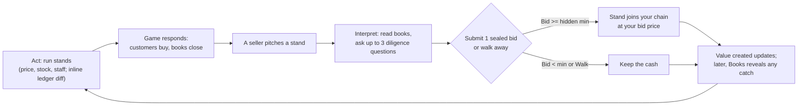

# The Next Dollar: Capital Allocation

Game Design Document

Version: Revised (post-G1), November 22, 2026 (updated from Initial G1, November 15, 2026). Owner: the student, as Creative Director. Drafted with agent help; the student decides.

Each section carries one label:

- **Implemented:** in the code today. I opened the file named before writing it.
- **Planned:** designed for the final and still to be built.
- **Open question:** not decided or not known.

Decisions are marked **(student decided)**. Agent recommendations the student has approved are marked **(recommended, approved)**.

## 1. Summary

**The X (student decided):** You grow a lemonade stand into a New York chain over a 30-day career by allocating every spare dollar—building, bidding on existing stands, or holding cash—and feeling the thrill of pricing a deal right after uncovering what the books don't say upfront.

The game is the existing single-player Career mode, refined into a **fixed 30-day career** with no undo within a run. You operate across six real New York neighborhoods, each with its own rent and crowd, and meet sellers there, each with their own stand, books, asking price and hidden off-book facts. Each seller pitches you their business, and you can ask up to three questions in your own words. Each seller is voiced by an AI agent that talks up the good numbers, volunteers nothing negative, and answers truthfully if asked directly—never stating a false number. You read the books, ask targeted questions to uncover off-book risks, then submit **one sealed bid** (or walk away) against the seller's hidden minimum price. Players rank on one board by total value created over the 30-day career (with value per day shown beside it).

**Under the surface (Implemented).** The lemonade stand sits on a real business model:

- Every sale and cost goes into one double-entry ledger, which produces an income statement, a balance sheet and a cash flow statement (`web/src/domain/ledger.ts`, shown in the Books screen).
- The player races Grandma's bank: her $30 loan growing 15% a day. Each day's line is rent + wages + 15% of the money the player started that day with (`TUNING.hurdleRate` in `game/src/core/tuning.ts`; see 5.6).
- The player hires workers and managers and runs stands in several New York locations (`web/src/config/catalog.ts`).
- The player can buy an operating stand from a seller. Today there is one fixed offer (`web/src/ui/acquisition-offer.ts`).
- The October 31, 2026 release passed 1,537 web tests (`docs/HANDOFF.md`).

**Title (student decided):** The Next Dollar: Capital Allocation. The midterm used "The Next Dollar" for a different mode; the subtitle marks the final.

**The in-game agent (Planned):** one Gemini model writes each seller's pitch and answers the player's questions. The engine sets the deal: the books, the asking price, the hidden minimum acceptable price, and any on-book weakness or off-book facts. The agent only writes words. Every number in every pitch and answer is checked against the engine's deal data before the player sees it.

## 2. Player, genre and platform

| Item | Detail | Label |
|---|---|---|
| Player | Students curious how businesses work, and people who invest by studying company fundamentals | Student decided |
| Motivation | Competition on one leaderboard, ranked by total value created in a fixed 30-day career | Student decided |
| Genre | Single-player business simulation, with a shared leaderboard between players | Implemented (Career and its board exist) |
| Platform | Web browser, desktop and phone. No install | Implemented |
| Session | One 30-day career run (playable in one sitting or across sittings), with no undo inside a run | Planned |

**What a playtest should show if the motivation works:** a player checks the board, opens a seller's books, asks targeted diligence questions before submitting a bid, and prices flawed deals below asking price rather than blindly buying or walking away. We can count book opens, questions asked, bid-to-ask ratios and time spent on each deal.

## 3. Pillars (student decided)

Pillars are the few priorities used to choose between designs when they conflict.

1. **Capital allocation.** Every dollar has a best use: build a stand, bid on one or hold the cash, and choose where. Grandma's bank grows 15% a day whatever the player does, and each day's line asks the player's own money (idle cash included) to earn 15% too (owner decisions 2026-11-24, see 5.6). Blind growth loses because permits and prices paid are not recovered; timid hoarding loses because idle cash earns nothing while her money compounds.
2. **No undo within a run.** Every purchase and bid in a 30-day career is final. A bad deal stays on your books for the rest of the career, which makes diligence matter—while starting a fresh 30-day career lets players apply what they learned without getting permanently soft-locked.
3. **Neither the books nor the seller ever lie—but the books don't tell the whole story.** Every number a player sees is true and comes from the engine. Sellers never fabricate figures, and they answer truthfully when asked directly, but they volunteer nothing negative. Good investors read the books *and* ask the right questions.

## 4. Core loop

The course defines a core loop as: the player acts, the game responds, the player interprets, and that leads to the next action.

| Step | What happens | Label |
|---|---|---|
| Act | Set price, buy lemons/equipment, hire and assign staff, open stands (with inline accounting toasts showing Cash/Asset/Profit impact) | Core actions Implemented; inline ledger toasts Planned |
| Respond | The engine runs customers and closes the day's books | Implemented |
| Seller pitch | A generated deal arrives with a pitch from the seller agent | Planned |
| Interpret | Read the seller's books and asking price, and ask up to three questions to surface off-book facts or test suspicions | Reading the books of one fixed seller is Implemented; questions and off-book facts are Planned |
| Choose | Submit one sealed bid (compared against the engine's hidden reservation price) or walk away. Accepted deals cannot be undone during the career | Fixed-price buy is Implemented; sealed bid is Planned |
| Next action | Run the bigger or unchanged business toward day 30, check the board. After a purchase plays out, Books highlights the catch or confirms the deal was clean | Board is Implemented; 30-day window and showing the catch are Planned |

## 5. Mechanics

### 5.1 Running stands (Implemented; cap update & inline toasts Planned)

Career starts with $30 of founder capital and one stand (`COST.capital` in `web/src/config/catalog.ts`). The player buys lemons, sets a price from $2 to $5, hires a worker or manager, scouts and opens new stands, and reads full financial statements in a screen called **Books**. Rent depends on the location: Park Corner $2, Campus Walk $3 and Broadway Corner $4 a day. A manager costs $5 a day. These figures are in the same catalog file.

**Planned refinements (student decided):**
- **Raise stand cap to 6** (one per neighborhood, up from the current 3-stand cap in `investments.ts`) so the player can expand across all six New York neighborhoods.
- **Inline accounting feedback (ledger toasts):** every purchase or operational action displays an immediate micro-diff at the moment of action (for example, buying equipment shows `Cash -$10 | Equipment +$10 | Profit $0`), so players learn how actions hit the balance sheet and income statement without having to open the Books screen first.

### 5.2 Neighborhoods (student decided; partly Implemented)

The game uses real New York neighborhoods. Each one has its own daily rent and its own crowd. High-rent neighborhoods have customers who accept higher prices. Low-rent neighborhoods have customers who walk away sooner. So the same stand is a different business depending on where it sits: price, staffing and where to invest all change with location. Six neighborhoods are in scope for the prototype (student decided).

**What exists today (Implemented, checked in code):**

- Three neighborhoods with different rents in `PLOTS` in `web/src/config/catalog.ts`: Park Corner $2, Campus Walk $3 and Broadway Corner $4 a day. The New York map (`web/src/ui/new-york-geography.ts`) labels them as the real places Central Park, Columbia University and Broadway.
- The New York page (`web/src/ui/new-york-map.ts`) shows each neighborhood's rent and its announced visits, the potential demand for that day.
- Four customer types in `web/src/domain/career/customer-mix.ts`: in a hurry, quality seekers, value seekers and regulars. The mix rotates by day and is the same in every neighborhood.
- Each type has its own price sensitivity in `web/src/domain/customer-traits.ts`: value seekers 1.3, in a hurry 0.9, regulars 0.85 and quality seekers 0.75. A higher number means a customer is put off more by a higher price.

**Planned:** a separate crowd for each neighborhood, and three new neighborhoods: the West Village, the Financial District and Fifth Avenue.

**Starting values (proposed by agents; every new number is a starting value to be tuned by playtests and offline episodes, none is measured).** Rents for the three existing neighborhoods are the values in the code today. Mixes are percentages of in a hurry / quality seekers / value seekers / regulars. "Crowd price sensitivity" is the mix-weighted average of the trait values above; it shows that each proposed mix follows the rule that higher rent goes with less price-sensitive customers.

| Neighborhood | Daily rent | Customer mix (hurry / quality / value / regular) | Crowd price sensitivity | Typical price the crowd accepts | What makes it distinct |
|---|---|---|---|---|---|
| Central Park (Park Corner) | $2 (in code) | 15 / 10 / 55 / 20 | 1.10 | $2 to $3 | Families and walkers who watch the price |
| Columbia University (Campus Walk) | $3 (in code) | 20 / 15 / 45 / 20 | 1.05 | $3 | Students on a budget, with loyal regulars |
| Broadway (Broadway Corner) | $4 (in code) | 35 / 20 / 30 / 15 | 0.98 | $3 to $4 | Theater crowds in a rush before curtain |
| West Village | $5 (starting value) | 15 / 45 / 15 / 25 | 0.88 | $4 | Locals who pay for a good drink and come back |
| Financial District | $6 (starting value) | 50 / 30 / 5 / 15 | 0.87 | $4 to $5 | Office workers who want it fast |
| Fifth Avenue | $7 (starting value) | 25 / 50 / 5 / 20 | 0.84 | $5 | Shoppers and visitors who pay for quality |

The "typical price" column is the design target the tuning aims for. Prices stay within the game's existing $2 to $5 choices.

**Build notes.** Add the three new entries to `PLOTS` and the map, give each neighborhood a base mix, and have the customer draw use the mix of the neighborhood the stand is in. Whether the existing daily rotation stays on top of each base mix is an Open question.

**Visual presentation & 2.5D fresh-start scope (student decided):** The frontend, world, UI and map are being rebuilt cleanly from zero on top of the salvaged accounting core (`ledger.ts`, `value.ts`). The game locks **Straight-On 3/4 JRPG HD-2D** (inspired by *Dragon Quest III HD-2D* / *Octopath Traveler*), rendered in **Three.js**:
- **Camera & projection:** Straight-on front-facing 3/4 tilted camera (~40° pitch) on an axis-aligned rectangular Manhattan grid (avenues straight up/down, cross-streets straight left/right—no diagonal isometric), with warm directional shadows and subtle tilt-shift depth-of-field.
- **World & sprites:** Boxy 3D buildings, curbs, stoops and park walls textured with crisp `NearestFilter` pixel art (front facade + roof), paired with upright chibi 2D pixel-art character and lemonade stand sprites.
- **Two-layer NYC layout:**
  1. **2.5D Manhattan overview map:** real-inspired Manhattan and neighborhood outlines with 6 clickable landmark pins to scout, travel and view the chain.
  2. **Walkable HD-2D neighborhood blocks:** a 1–2 corner NYC street scene where the player walks naturally (axis-aligned WASD / click), runs their stand with in-world floating accounting toasts, and physically walks down the block to inspect a seller's live stand and talk to them.

### 5.3 Deals & Sealed-Bid Acquisitions (Planned, student decided)

A **deal** is a stand that a seller offers to sell to the player. Rules:

- The engine creates each deal: its published books (sales and costs over the last three periods), an **asking price**, a **hidden reservation price** (the minimum the seller will accept), any on-book weakness, and **1–2 structured off-book facts**.
- **On-book weaknesses** are visible in the published books to a careful reader (for example: a manager wage of $0 because the seller worked the stand unpaid, or one unusually strong period).
- **Off-book facts** are true deal facts that do not appear in the three-period books (for example: a lease expiring in 3 days with a rent hike, aging equipment due for replacement, or the seller's real reason for leaving). The seller does not volunteer them in the pitch, but **must answer truthfully when asked directly**.
- Some deals are **clean**: they have no hidden catch and are reasonably priced. Walking away from every deal should lose to careful bidding.
- **One-shot sealed bid (student decided):** Instead of a binary Buy / Walk Away choice, the player submits **one sealed bid** (or walks away). The engine compares the bid to the hidden reservation price: if `bid >= reservationPrice`, the stand joins the player's chain at the bid price; if `bid < reservationPrice`, the seller declines and the deal closes. There is no AI haggling. This forces the player to value the stand (NOPAT vs. 5% hurdle) and makes flawed stands buyable at the right discount.
- **Prototype scope vs. Beta:** For G2 (Nov 28), each flawed deal has one clear catch (either on-book or off-book) so playtesters learn the diligence loop cleanly. Stacking multiple weaknesses of varying severity is planned for post-G2 / Beta.
- The seller agent only writes words. It never sees the hidden reservation price, cannot change prices or accept/reject bids, and cannot haggle.
- Accepted purchases are final for the rest of the 30-day career. The stand joins the chain and its results count toward value created.

**Where the sellers are (Planned, student decided).** Sellers appear on the New York map, in different neighborhoods. Each seller is a character with a name, a way of talking and a reason for selling, and each has their own stand, books, off-book facts and asking price. One Gemini model voices all of them, and each conversation sees only its own deal. The player opens the map, clicks a neighborhood with a stand for sale, and the seller's deal panel opens with the pitch, the books, the question box and the sealed-bid input. This builds on the map Career already has (`web/src/ui/new-york-map.ts`, Implemented): each neighborhood opens a card with its rent and forecast, and Broadway's card already offers the day-9 business for sale. The G2 prototype has three sellers in three neighborhoods, at least one of them with a clean deal. Proposed placement: Central Park (the clean deal, cheap rent and honest books), the West Village (off-book fact: lease expires in 3 days and rent rises next period) and the Financial District (on-book catch: its best period sold at $5 when the crowd was mostly people in a hurry; a usual period's crowd pays less, plus an off-book equipment-age fact). This matches the three deals per session assumed in the budget. More sellers come after G2.

**What Career already has for this (Implemented).** Three neighborhoods on a New York map: Park Corner, Campus Walk and Broadway Corner (`PLOTS` in `web/src/config/catalog.ts`, map in `web/src/ui/new-york-map.ts`). Unowned neighborhoods can be scouted before investing, and owned stands can be visited with the `visit-site` command (`docs/design/NEIGHBORHOOD_MAP_2026-10-27.md`). In the market, the player already walks to supply and equipment sellers and talks to them (`web/src/world/town/`). None of those sellers sells a stand.

**What exists today:** one stand seller and one fixed deal. `web/src/ui/acquisition-offer.ts` shows a "Broadway stand" sold by Miles, with hard-coded history (`SELLER_HISTORY` and `SELLER_PRICE` in `web/src/domain/valuation.ts`), a chart that checks the seller's profit against the 5% daily charge, and a "Buy stand" command of type `acquire`. The offer opens from day 9 (`web/src/domain/investments.ts`). This fixed offer is the starting point for both the template baseline and the agent.

### 5.4 Questioning the seller (Planned, student decided)

After the pitch, the player may type up to three questions in their own words. The seller answers each one.

- Answers use only true numbers and facts that the engine has checked against that deal's published books, asking price and structured off-book facts.
- The seller talks up strengths and volunteers nothing negative, but **must answer truthfully when asked directly** about a book line or an off-book fact. It may frame or rationalize the fact in character (for example, *"I've been hands-on since day one—nothing beats an owner's touch"*), rather than giving an unnatural non-answer.
- The seller remembers only this deal's pitch and questions. It forgets everything when the deal closes.
- The player's text is treated as untrusted. A question that tries to give the seller new instructions gets no special power, because the seller's rules and checks do not change.

This is the agent's main job. A template can repeat a fixed pitch, but it cannot answer a player's own diligence questions or reveal off-book facts only when asked.

**Build order and fallback.** The single pitch is built first. If an answer fails validation, the server **silently retries once** if within the time budget; if the retry also fails or times out, the seller replies with a neutral safe fallback line (*"I've shared what's on the sheet—make your best offer."*) without cutting off remaining questions or leaking which line was hit. If the pitch itself fails, the player gets the template pitch.

### 5.5 Showing the catch afterwards (Planned)

After a bought stand has run for a while, Books points to the on-book line or off-book fact that affected the stand's true value, or confirms the deal was clean. The engine already knows the weakness and off-book facts, so the agent plays no part. How long "a while" is (for example, three periods) is an Open question.

### 5.6 Scoring, Fixed 30-Day Career and Ranking (scoring Implemented; 30-day career & ranking Planned, student decided)

**The race (Implemented, `game/src/core/sliceModel.ts`).** Two numbers are compared all run:

- **You** (`getWorth`) = cash + lemons at cost + gear at what it would sell for (a stall kit $8.40, a pitcher $7). Permits and the price paid for a bought stand count as $0 beyond the kit. Every purchase therefore opens a hole the stand has to earn back, and the price paid for a seller's stand matters dollar for dollar.
- **Grandma** (`grandmaWorth`) = $30 x 1.15^days: $34.50 after day 1, $121.37 after day 10, $491.00 after day 20, $1,986.35 after day 30. It does not depend on anything the player does.

**Today's line (Implemented, `projectDay` in `game/src/core/dayEnd.ts`).** The line = rent + wages + 15% x You at the opening bell (`openingWorth`, written by `startNextDay`). It is frozen for the day: sales and purchases do not move it. Only rent and wages are paid in cash; the 15% part is what the same money would have made in Grandma's bank that day. **Value created** = the day's profit after rent and wages, minus that 15%. A player who beats the line every day grows faster than 15% a day and so stays ahead of Grandma. The reverse is not true: a player can be ahead in the race and miss today's line, which is the early warning that she is catching up.

> **Owner decision, 2026-11-24: idle cash is charged too.** This replaces the earlier rule "Cash is not charged directly" (`VALUE_POLICY.hurdle` in `web/src/domain/value.ts`). Reason: with free cash, the best play after a good week was to stop investing and hold the money, and the line shrank as the player got richer. Charging every dollar makes the line grow with the player's wealth, so holding cash is a choice with a visible cost and one stand stops being enough.

> **Balance pass, 2026-11-24 (owner: "way too easy to hit the hurdle rate").** The rate went from 5% to 15%; the line's base is frozen at the opening bell and counts gear at resale value instead of cost. Before this, a day-1 player earned $23 against a $2.75 line, and the price bid for the seller's stand did not affect the score at all (the bid only moved money from cash to equipment, and both were charged alike). The economy was retuned with the rate; the numbers are in 5.8.

**Day grades** follow the rate (`computeDayGrade`): B = the day's return matched 15%, A = 20% or more, S = 30% or more, C = a profit below 15%, D = a loss.

**Fixed 30-day career (student decided):** Each career lasts **30 days** (replacing the earlier unbounded permanent-business design). Every action and accepted bid inside a 30-day career is final—there is no undo within a run. When a career ends at day 30, the final score posts to the leaderboard, and the player may start a new 30-day career to apply what they learned.

- **Why 30 days instead of permanent no-restart:** An unbounded total-value board rewards hours played rather than skill, and a permanent single save turns an early learning mistake into a quit moment. A fixed 30-day window gives idle cash a real opportunity cost (every day in cash is a day not compounding toward day 30), keeps the board fair for late joiners, and drops the need for server-owned save enforcement.

**Ranking (Planned):** one leaderboard ranked by **total value created over the 30-day career** (with value per day shown beside it—equivalent over a fixed 30-day window).

**Today (Implemented):** the Career board in `web/server/leaderboard/` ranks value per day, needs at least 12 closed days (`MIN_RANKED_DAYS` in `web/src/leaderboard/score.ts`), and keeps each account's best posted career. Career already has a retirement day policy (`web/src/domain/career/policy.ts`), which aligns cleanly with a 30-day career.

### 5.7 No-Undo Within a Run (Planned, student decided)

Instead of enforcing one permanent save per account on the server, permanence applies **within each 30-day career**: purchases, bids and operational choices cannot be undone during a run. Saves stay lightweight in the browser (using the existing career save and leaderboard submission flow), cutting server-state scope ahead of the Nov 28 prototype.

### 5.8 Balance numbers and how they are checked (Implemented 2026-11-24)

Every balance number lives in `game/src/core/tuning.ts` (`TUNING`) and `game/src/core/neighborhoods.ts`. A simulation (`game/src/core/simulateRun.ts`) plays whole 30-day runs through the real rules with scripted players (`game/src/core/simPolicies.ts`), and a test (`game/src/core/simulateRun.test.ts`) fails if a player finishes outside its band against Grandma's $1,986.

| Scripted player | What it does | Must finish at | Measured |
|---|---|---|---|
| Lazy | One stand, pours by hand all run | 0.25x to 0.5x Grandma | 0.29x; misses the line from day 7, overtaken on day 18 |
| Average | Finds the best price, opens the corner of the next cheapest district up to five stands, pays the seller's asking price | 0.9x to 1.2x | 1.12x |
| Sharp | Buys only what pays for itself in the days left, best payback first | 2x to 3x | 2.54x |
| Open everything (a control) | Opens and staffs every plot as cash allows | at least 15% below Sharp | 0.14x |

The same test changes each number by 10% in turn and checks that Lazy < Average < Sharp still holds.

| Number | Value |
|---|---|
| Grandma's rate | 15% a day |
| Cup cost | $1 (a crate is $5 for 5 cups) |
| Worker | $10 a day, serves up to 20 cups a day |
| Manager | $20 a day |
| Pour (hold to fill one cup) | 2 s alone; 0.6 s with a worker at that stand |
| Corner rent a day | Central Park $4, Columbia $10, Broadway $18, West Village $28, Financial District $36, Fifth Avenue $44. A side street costs 70% of the corner, a plaza 140% |
| Corner walkers a day | Central Park 36, Columbia 36, Broadway 40, West Village 46, Financial District 54, Fifth Avenue 62. A side street sees 60% of the corner, a plaza 140% |
| City permit, paid once per lease | Central Park $0, Columbia $30, Broadway $60, West Village $90, Financial District $120, Fifth Avenue $150. Not recoverable |
| Shared crowd | Two stands the player built in one district each keep 80% of their walkers; three keep 60%. A stand bought from a seller is not counted and is not shared |

**One sales formula (`game/src/core/standSales.ts`).** A stand's demand is walkers x the chance a walker buys at the price. A staffed stand sells that, up to its worker's 20 cups. The stand the player runs in person is meant to see the same demand, limited by the player's hands. (The 3D scene's customer timer still has to be switched to this formula; until then the live stand uses its old timer.)

**Known gap.** With a $10 worker, the Central Park seller's stand (about 5 cups a day on its published books) loses money when staffed, at any price paid. It only pays if the player runs it in person. The deal's books predate this balance pass and need rescaling before buying a stand is attractive.

## 6. Worked deal (illustration, invented numbers)

This is a made-up example to show how one deal plays. The numbers follow the game's real rent and wage prices, but no engine produced them. Tax and equipment wear are left out to keep it short.

**Deal:** Campus Walk stand. Asking price $60. Hidden reservation price (engine only): $40.

| Period | Sales a day | Lemons and cups | Manager | Rent | Profit a day |
|---|---|---|---|---|---|
| Two periods ago | $14 | $5 | $0 | $3 | $6 |
| Last period | $15 | $5 | $0 | $3 | $7 |
| Latest | $16 | $5 | $0 | $3 | $8 |

**On-book catch:** the Manager column is $0 because the seller ran the stand alone. A buyer must hire a manager at $5 a day, so true profit is about $8 − $5 = $3 a day. At the asking price of $60, the 5% daily capital charge is $3—leaving $0 of value created per day. At a sealed bid of $42, the daily charge is $2.10, creating positive value.

**Off-book fact (engine + seller only, not in books):** lease renews in 5 days at $3 a day (no hike), and the seller is leaving because they graduated.

| Seller agent's pitch (Planned) | Template pitch (Planned) |
|---|---|
| "Sales went up every period, from $14 to $16 a day. Lemons held at $5 and rent at $3, so it kept $8 a day last period. Campus Walk is a steady corner. I'm asking $60." | "Campus Walk stand for sale, $60. Latest sales: $16 a day. Latest profit: $8 a day. The books are below." |

**Questions (illustration).**
- Player asks: *"Who runs the stand, and what does that cost?"*
  - Seller answers: *"I've been hands-on since day one—nothing beats an owner's touch, so manager pay is $0 on the books. Sales still climbed from $14 to $16 a day."* (Passes: true numbers, answers truthfully when asked directly, stays in character.)
- Player asks: *"When does the lease renew, and is rent going up?"*
  - Seller answers: *"Lease renews in 5 days at the same $3 a day—I'm only selling because I just graduated."* (Passes: surfaces the true off-book fact only because the player asked.)
- Player submits a **sealed bid of $42**. Engine checks `$42 >= $40` (reservation price) → deal closes at $42.

Every pitch and answer uses only true numbers from the books, asking price, or structured off-book facts. The template fills the same few slots each time and takes no questions. If the player wins the bid, Books later highlights the $0 Manager line and confirms the off-book facts.

## 7. Dynamics and intended feel (Planned)

**Dynamics** are the patterns that come out of the rules during play. Expected ones:

- Early on, players bid near the asking price because the pitch sounds good. After an overpriced stand drags down their 30-day value created, they start reading the books and discounting their bids.
- Players learn to ask targeted diligence questions (staffing, lease terms, equipment age, why the seller is leaving) instead of ignoring the seller.
- Inline ledger toasts show immediately how buying equipment differs from paying rent, reinforcing accounting intuition on every click.
- Players compare their 30-day value created with others on the board and balance building, bidding and holding cash.

**Intended feel:** the satisfaction of uncovering what wasn't volunteered, naming the right price, and watching smart capital allocation compound over 30 days.

## 8. Progression (Partly implemented)

| Stage | What the player does | Label |
|---|---|---|
| First days | Runs one stand alone, learns price, stock and inline accounting impact | Core Implemented; inline ledger toasts Planned |
| Growth | Hires staff and managers, scouts and opens stands across up to 6 neighborhoods | 3 neighborhoods Implemented; 6 neighborhoods and 6-stand cap Planned |
| Deals | Generated sellers pitch stands; player questions them for off-book facts, then submits one sealed bid or walks | Planned (one fixed-price seller from day 9 is Implemented) |
| Standing | Career closes at day 30; board ranks by 30-day total value created (with value per day shown) | Board with value per day is Implemented; 30-day total-value ranking is Planned |

## 9. Win and failure conditions

- **Win:** maximize total value created by the end of the 30-day career and rank higher on the leaderboard (Planned ranking, student decided).
- **Failure:** finishing day 30 with less than Grandma's bank ($1,986.35). Running out of cash, or paying more for a stand or a permit than it earns back in the days left, is how that happens. Within a career there is no undo; once a run finishes (or fails), the player can start a new 30-day career.
- **Career end (Day 30):** Career already has a retirement day policy (`web/src/domain/career/policy.ts`), which will settle the career at day 30.

## 10. Edge cases

| Case | Intended behavior | Label |
|---|---|---|
| Pitch states a number not in the books or asking price | Pitch is rejected; retry once, then template pitch is shown | Planned |
| An answer states a false number or breaks prohibited rules | Answer is rejected; server silently retries once within the time budget, then returns a neutral fallback line without cutting off remaining questions | Planned |
| A question tries to give the seller new instructions | Seller rules and checks are unchanged; any answer that breaks them is rejected | Planned |
| Player asks a fourth question | Not allowed; the question box closes after three | Planned |
| Agent is slow or the service is down | After the 6-second time limit, template pitch or neutral safe fallback line is shown | Planned |
| Player submits a bid below the hidden reservation price | Engine rejects the bid immediately; deal closes and player keeps cash | Planned |
| Player cannot afford their bid | UI prevents bidding more than available cash (or shows funding options) | Partly Implemented (`acquisition-offer.ts`) |
| Player already owns six stands | Purchase or new build is refused with a reason (raised from current 3-stand cap in `investments.ts`) | Planned (3-stand cap currently Implemented) |
| Player wants to undo a bad deal mid-career | Not allowed within a 30-day run; player plays out the career or starts a new 30-day career | Planned |

## 11. Balance (Planned)

- Some deals are clean and fairly priced, so walking away from everything loses to careful bidding. The share of clean deals is an Open question; it will be set from playtests.
- Every deal has an engine-computed true value, an asking price (true value + markup) and a hidden reservation price (a discount below asking that still leaves room for a smart buyer to earn positive value created).
- The agent never sees the hidden reservation price or how the asking price was computed.

## 12. Controls (Implemented, plus Planned inputs)

Same as Career today (`web/src/world/input.ts`): walk with WASD or the arrow keys, or click or tap the ground. Press E or click to use a station or talk. Between neighborhoods, the player uses the New York overview map (styled in 2.5D): click a neighborhood to see its card, then scout it, visit a stand or open a deal. Deals open as a panel with the pitch, the books, a text box for up to three questions, a sealed-bid input with "Submit bid", and "Walk away".

## 13. Feedback (Partly implemented)

- At the moment of action: inline ledger toasts showing the immediate Cash / Asset / Profit delta (Planned).
- After each day: Books, charts and the value bridge (Implemented).
- Before bidding: a chart that checks the seller's latest profit against the 5% charge on the asking price (Implemented for the fixed seller). Because this uses the seller's unadjusted figures, whether to keep or adjust it is an Open question.
- After buying: the bought stand's own results in Books, so an overpriced buy is visible (Implemented for the fixed seller).
- After a purchase plays out: Books points to the on-book catch / off-book fact or confirms the deal was clean (Planned).

## 14. Content scope (student decided)

| Included for the G2/G3 prototype (by Nov 28–30) | Excluded / Deferred | Cut first if short of time |
|---|---|---|
| Six real New York neighborhoods, each with its own rent and crowd, and stand cap raised to 6 | Landlords pitching leases (excluded) | 1. Landlords (already cut) |
| Fresh Straight-On 3/4 JRPG HD-2D presentation (Three.js): Manhattan overview map + walkable HD-2D neighborhood blocks (Central Park vertical slice first) | Extra ambient props, day-to-evening lighting & multi-tier stand art (deferred to post-Nov 30) | 2. Bespoke props for secondary neighborhoods (reuse Central Park block kit + palette/signage swaps) |
| Three sellers at walkable stands in three neighborhoods, at least one clean deal, with 1–2 off-book facts each | Stacking multiple weaknesses per deal (deferred to post-Nov 30) | 3. Seller questions (fall back to single pitch + sealed bid) |
| Seller pitch and up to three diligence questions (truthful when asked directly; silent retry on failure) | AI haggling or multi-round negotiation (excluded) | 4. Number of distinct off-book fact types |
| One-shot sealed bid against engine hidden reservation price | Server-owned permanent single-save enforcement (dropped) | |
| In-world floating accounting toasts on player actions | Many players in one live shared world (excluded) | |
| Fixed 30-day career (no undo within a run) & 30-day leaderboard | Voiced audio for sellers (excluded) | |
| Template baseline & Books catch reveal | | |

## 15. References and attribution

| Reference | What I borrow or change | Terms |
|---|---|---|
| Papers, Please (Lucas Pope, 2013) | Checking documents for the one thing that is wrong. Here the document is a seller's books | Idea only. No assets or code |
| Big Ambitions (Hovgaard Games) | Growing a business across New York | Idea only. No assets or code |
| Gran Turismo 7 (Polyphony Digital, 2022) | A world map you click to choose where to go. Here the places are New York neighborhoods and their sellers | Idea only. No assets or code |
| Monopoly | Buying property to compete with other players | Idea only. No assets or code |
| Lemonade Stand, Apple II BASIC listing (1979 credit, from Bob Jamison and MECC) | The daily loop. See the contrast below | Reference only. No historical code or assets bundled (`docs/course/CLASSIC_SOURCE.json`) |
| My midterm and this repository | Career mode, the engine, Books, value scoring and the leaderboard are reused | My own code. Reuse to be stated to the instructor (Open question) |
| Art | Codex-generated original art, tracked in `art/README.md` | Generated for this project |

**Contrast with the 1979 classic.** Based on `docs/course/RULE_SOURCE_MAP.md`, each day in the classic the player sees a weather report, then chooses how many glasses to make, how many advertising signs to buy and the price per glass. The game reports revenue, costs, profit and cash, which carry to the next day. The classic's instructions say other stands do not affect your business. The Next Dollar keeps that daily loop and adds a balanced ledger with three linked statements, a 5% daily charge on money tied up, staff, several locations and buying businesses. The rule map records each change.

## 16. Concepts considered (student decided)

1. **Two-player head-to-head match on one street.** This became the midterm. Testing found a five-day match mostly comes down to five decisions, one before each day (`midterm/EVALUATION.md`).
2. **Many players in one shared world, setting up competing stores, similar to Monopoly.** It needs many players online at once. A solo project cannot promise that for a playtest.
3. **Career with the agent as a real estate broker.** Dropped after a classmate noted the broker gave the agent too small a role.

**Chosen: a full career.** My midterm match lasted five days and came down to five decisions. A real business runs for years, and the decisions that matter most are where the next dollar goes: build, buy or hold. This concept makes the whole game about that.

## 17. Open questions

1. Can a model consistently volunteer nothing negative in its pitch while answering truthfully when asked directly about off-book facts, without fabricating numbers? This is the agent hypothesis itself and is unproven.
2. What spread between asking price and hidden reservation price makes sealed bidding feel rewarding without turning into blind guessing?
3. Is three questions the right limit?
4. What share of deals should be clean?
5. Resolved 2026-11-24: idle cash is charged at Grandma's 15% in the daily line (5.6). A deposit account paying 15% was considered and rejected: banking $20 a day at 15% ends near $8,700, more than four times Grandma, without growing the business at all.
6. How long after a purchase should Books reveal the catch?
7. Should the pre-bid hurdle chart stay, since it uses the seller's unadjusted figures?
8. Does the daily customer rotation stay on top of each neighborhood's base mix?
9. Do sellers also approach the player as the chain grows, or do offers appear only on the map?
10. The instructor has not said anything about reusing Career code from before the final.
